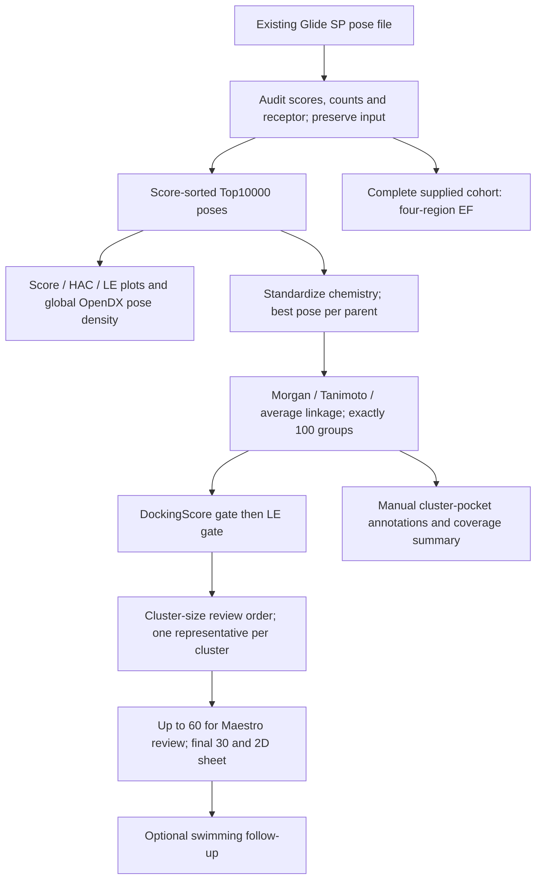
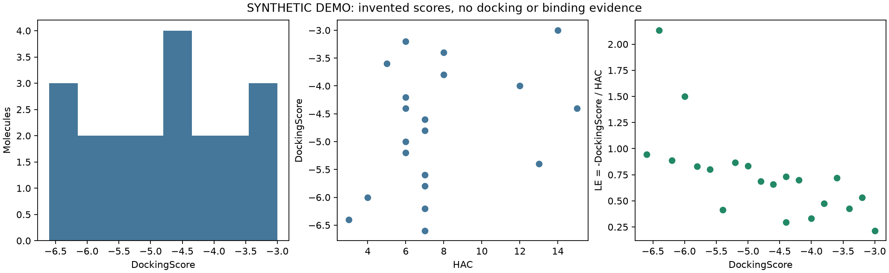
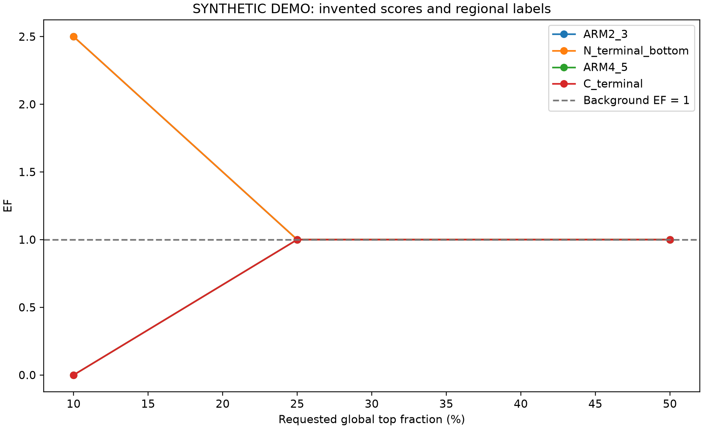

# Glide Fragment Screen

**Reproducible analysis of a β-catenin Glide SP screen: chemical diversity, spatial pose distributions, regional enrichment and traceable candidate selection.**

[中文说明](README.zh-CN.md) · [Server runbook](docs/RUNBOOK.md) · [Methods](docs/METHODS.md) · [Evidence](docs/EVIDENCE.md) · [Validation](docs/VALIDATION.md)

Developed around a researcher-reported screen of approximately **60,000 small molecules**. The workflow starts with existing Glide poses, audits the supplied cohort, analyzes up to 10,000 score-ranked poses, groups standardized chemical parents into **exactly 100 clusters**, and exports up to 60 candidates for structural review and a final 30-compound shortlist.

**Status:** docking and earlier clustering/manual screening were performed by the researcher. The current fixed-100/sequential implementation is available for server reruns. Public examples use synthetic scores and labels; they do not identify β-catenin binders or inhibitors. Private campaign inputs and full-campaign validation are not included.

## Scientific workflow



## Analysis decisions

- **Audit before ranking:** distinguish poses, titles, ligand states and standardized parents; verify what a file named `truncated_hits..maegz` actually contains.
- **Explore chemistry and space separately:** chemical clustering does not assign a binding site. Pose-density maps and manual pocket annotations address spatial distributions.
- **Make selection explicit:** DockingScore → score-derived LE → cluster-size review order. No 60/30/10 composite weighting, cross-docking requirement or automatic filling of candidate shortages.
- **Quantify regional enrichment:** compare the fraction of top-scoring parents assigned to a region with its fraction in the complete supplied background. Keep outside/ambiguous/unassigned cases in the denominator.
- **Preserve provenance:** source entries, input hashes, stage tables, actual cutoffs, candidate counts, logs and review-sheet hashes.

The default score-top 2,000 and LE-top 500 are adjustable review budgets. Exactly 100 groups is a coarse view of chemical space, not a similarity guarantee. Cluster size describes the sampled library, not binding confidence.

## Quick start: public CPU demo

Python 3.10+; no Schrödinger license, private structures or GPU required:

```bash
python -m venv .venv
source .venv/bin/activate
python -m pip install -r requirements.txt
python -m unittest discover -s tests -v
python scripts/demo.py --out demo_output
```

Windows activation: `.venv\Scripts\Activate.ps1`. The demo uses 20 toy molecules and five clusters; a separate regression test verifies an exact 100-cluster cut. Its scores and region labels are invented.





## Analyze existing docking results

Use a licensed Schrödinger Python environment with compatible RDKit, NumPy, SciPy and Matplotlib. Start with a small real-data smoke test. This postprocessor does not rerun docking.

```bash
"$SCHRODINGER/run" python3 scripts/run_analysis.py \
  --input /private/docking/truncated_hits..maegz \
  --out results/glide100 \
  --n-clusters 100 --score-top 2000 --le-top 500
```

To include regional EF, add `--with-ef --ef-input /private/docking/full_poses_pv.maegz`. EF reads that complete supplied file, not the exported Top10k. Add `--receptor` in the original docking frame if needed and `--chain A` only after verifying the construct. If only truncated poses are available, report **EF within that truncated cohort**.

Saved parent CSVs can be reclustered in an independent open-source environment without Schrödinger:

```bash
python scripts/cluster_glide_top1w.py \
  --input-csv /private/previous/cluster_assignments.csv \
  --output-dir results/recluster100 \
  --n-clusters 100 --score-top 2000 --le-top 500
```

CSV mode produces tables and figures; original MAEGZ chemistry is required for pose exports. [Complete commands and output checks](docs/RUNBOOK.md).

## Four exploratory regions

| Region | Residue anchors |
| --- | --- |
| ARM2_3 | Met202, Thr205, Lys242 |
| N_terminal_bottom | Met189, Glu226, Lys233 |
| ARM4_5 | Leu286, Asn326 |
| C_terminal | Leu644, Ser681 |

Default EF assignments use an 8 Å sphere around each group's mean Cα position and a 2 Å ambiguity gap. These are operational neighborhoods requiring visual review, **not anatomical pocket boundaries**. Reviewed region definitions or existing pose labels are supported. [EF interpretation](docs/REGIONAL_EF.md).

## Repository map

| Path | Purpose |
| --- | --- |
| `scripts/run_analysis.py`, `prepare_top_hits.py` | Logged orchestration, audit and stable Top N export |
| `scripts/analyze_global_glide_1w.py` | DockingScore/HAC/LE plots and normalized OpenDX maps |
| `scripts/cluster_glide_top1w.py`, `fixed_clusters.py` | Standardized parents, exactly K groups, medoids and cohesion plots |
| `scripts/sequential_selection.py`, `selection_sensitivity.py` | Sequential gates, strict caps and threshold sensitivity |
| `scripts/calculate_pocket_ef.py`, `plot_le_analysis.py` | Regional score enrichment and score/size trade-offs |
| `scripts/review_cluster_pockets.py` | Maestro review sheet and cluster/pocket heatmap |
| `scripts/draw_top100_2d.py`, `export_manual_top30.py` | Structures with name, score, LE, cluster and pocket |
| `scripts/plot_volume_occupancy.py` | Optional: annotate existing ARM4–5 volumes with MED occupancy |
| `docs/`, `tests/`, `.github/`, `slurm/` | Methods, server workflow, tests, CI and scheduling example |

## Interpretation and availability

DockingScore axes omit units. `LE_score = −DockingScore/HAC` is a docking-derived size normalization; it is not experimental LE and is not converted to Kd. Regional EF measures **winning-pose score enrichment**, not active/decoy validation or calibrated druggability. Protein-centroid grid placement alone does not establish whole-protein coverage.

The optional MD module preserves zero estimates, separates cavity detection from detected-positive volume, and omits the static-reference line. Occupancy/volume comparisons are descriptive; correlated trajectory frames are not independent replicates. [Swimming interface](docs/SWIMMING_INTERFACE.md).

Project-authored code is MIT licensed. Schrödinger software, private libraries and trajectories are separate dependencies and are not distributed. The related [AF3 Ligand Screen](https://github.com/l1zhx/af3-ligand-screen) covers structure-prediction orchestration and assessment; it is not required by this docking workflow.
