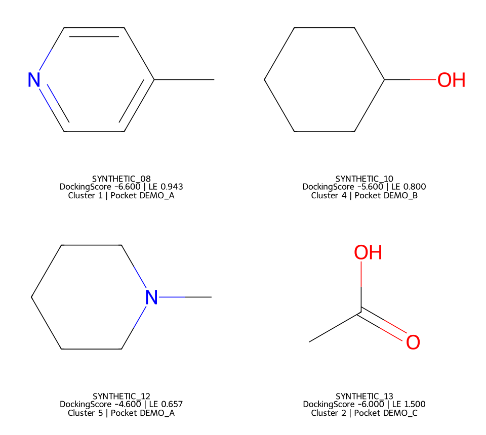
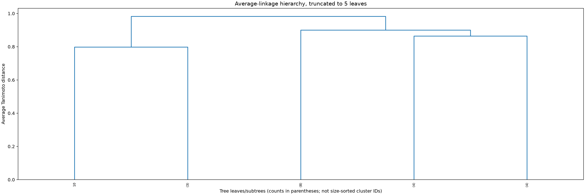

# Validation record — 2026-10-27

Local environment: Windows, Python3.12, RDKit2026.09.1, NumPy2.5.4, SciPy1.18.1 and Matplotlib3.11.2. These are public-demo versions, not a claim of compatibility with every licensed Schrödinger release.

**29 regression tests passed, no skips.** Checks cover:

- Exactly100 nonempty groups from125 controlled fingerprints, condensed-distance ordering and infeasible counts.
- Score/LE stage order, exact boundary ties, cluster caps, strict shortages and optional review-alert exclusion.
- Stable pose-level Top N ordering, manual rank/pocket mapping, LE/depiction labels and density bounds/smoothing.
- Four correct residue groups, chain/missing-anchor errors, geometry ambiguity/outside cases, best-parent retention and EF denominators/ties.
- Review-sheet source hashes, missing labels and duplicate entries.
- Occupancy time alignment, invalid/missing states, preserved detection zeros, unknown other-fragment states, conditional summaries and omission of static reference.
- LE recomputation from the best supplied parent score.

The extended20-molecule synthetic demo completed: five chemical groups, seven of eight requested review candidates, four manual depiction examples, regional EF arithmetic, cluster/pocket review joins and LE/size figures. The shortage is reported without relaxing gates or caps. Scores and labels are invented.

[Machine-readable demo record](assets/demo_report.json).

The tests do not establish experimental binding, inhibition, full-grid coverage or druggability. Full10k performance, licensed MAEGZ conversion, server orchestration and Slurm execution remain to be verified with the user's private inputs. No real new Top30 or full-campaign EF was computed here. GitHub-hosted Linux CI is configured but is not reported as executed before publication.

For a server smoke test, choose a small scored input with an explicit feasible --n-clusters, verify entry counts/score fields/receptor coordinates and original exported chemical states in Maestro, then scale to100 clusters. Archive the actual vendor release, run time, peak memory, input hashes and all rejected entries.
